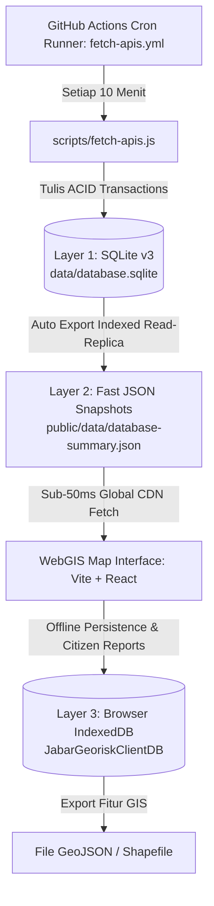

# Arsitektur Database Paling Efektif untuk WebGIS & EWS Jawa Barat

> **Disusun:** 27 Oktober 2026  
> **Status:** Terimplementasi & Aktif  
> **Pendekatan:** *Serverless Tri-Layer Edge Geospatial Database* (Zero-Cost, Zero-DevOps, High-Speed)

---

## 1. Mengapa Arsitektur Ini "Paling Efektif"?

Dalam proyek WebGIS kebencanaan berskala provinsi yang di-host di platform statis/edge (GitHub Pages, Vercel, Netlify) dengan otomasi GitHub Actions, database tradisional (seperti AWS RDS / Cloud PostgreSQL) memiliki banyak kelemahan:
- **Biaya bulanan** ($15 – $50+/bulan) meskipun tidak ada pengguna yang membuka peta.
- **Overhead koneksi**: Manajemen connection pool, IP whitelist, lag latensi, dan downtime risiko server.
- **Beban komputasi client**: Query langsung dari browser ke database relational lambat dan rentan pembocoran kredensial (SQL Injection / credential leak).

### Solusi Terbaik: *Tri-Layer Edge Engine*
Sistem ini menggunakan perpaduan 3 layer database yang saling melengkapi:



| Layer | Teknologi | Peran & Keunggulan | Biaya |
|---|---|---|---|
| **Layer 1: Authoritative Relational DB** | **SQLite v3** (`data/database.sqlite`) via native `node:sqlite` | Single-file database standar dunia GIS, WAL mode aktif, zero external dependency, terindeks rapi, kompatibel langsung dengan QGIS, ArcGIS, dan Python. | **Gratis (0 IDR)** |
| **Layer 2: Fast Static Read-Replica** | **JSON CDN Views** (`database-summary.json` & `live-telemetry.json`) | Dibangun otomatis saat SQLite diperbarui. Browser mengakses data dalam kecepatan &lt;50ms tanpa beban koneksi SQL. | **Gratis (0 IDR)** |
| **Layer 3: Client Decentralized Storage** | **Browser IndexedDB** (`JabarGeoriskClientDB`) | Menyimpan laporan warga (*Citizen Science*) secara offline saat berada di lereng/gunung tanpa sinyal internet, caching telemetri, dan ekspor GeoJSON. | **Gratis (0 IDR)** |

---

## 2. Struktur Skema Tabel SQLite (`data/database.sqlite`)

### 1. `telemetry_logs` (Time-Series Sensor Cuaca & Tanah)
Menyimpan riwayat sensor 7 stasiun pemantauan kunci Jawa Barat:
```sql
CREATE TABLE telemetry_logs (
  id INTEGER PRIMARY KEY AUTOINCREMENT,
  timestamp TEXT NOT NULL,
  station_id TEXT NOT NULL,
  lat REAL,
  lng REAL,
  temp_c REAL,
  humidity_pct REAL,
  rainfall_mm REAL,
  status TEXT
);
CREATE INDEX idx_telemetry_ts ON telemetry_logs (timestamp);
CREATE INDEX idx_telemetry_station ON telemetry_logs (station_id);
```

### 2. `earthquakes` (BMKG TEWS)
Merekam data gempa bumi terkini dan riwayat goncangan:
```sql
CREATE TABLE earthquakes (
  id TEXT PRIMARY KEY,
  datetime TEXT NOT NULL,
  magnitude REAL,
  depth_km REAL,
  coordinates TEXT,
  lat REAL,
  lng REAL,
  region TEXT,
  potensi TEXT,
  shakemap_url TEXT,
  created_at TEXT
);
CREATE INDEX idx_earthquakes_datetime ON earthquakes (datetime);
```

### 3. `landslide_events` (Historis Kebencanaan BNPB 2021–2025)
Mencatat bencana riil georisk Jawa Barat (Cianjur 2022, Sumedang 2023, Kertasari 2024, dll):
```sql
CREATE TABLE landslide_events (
  id TEXT PRIMARY KEY,
  year INTEGER NOT NULL,
  nama TEXT NOT NULL,
  tanggal TEXT,
  lat REAL,
  lng REAL,
  wilayah TEXT,
  sesar_pemicu TEXT,
  korban_meninggal INTEGER DEFAULT 0,
  korban_luka INTEGER DEFAULT 0,
  mengungsi INTEGER DEFAULT 0,
  rumah_rusak INTEGER DEFAULT 0,
  korelasi_longsor TEXT,
  status_bnpb TEXT
);
CREATE INDEX idx_landslide_year ON landslide_events (year);
```

### 4. `soil_classifications` (27 Kabupaten & Kota se-Jawa Barat)
Menyimpan taksonomi tanah, karakteristik USDA, dan kerawanan longsor:
```sql
CREATE TABLE soil_classifications (
  id INTEGER PRIMARY KEY AUTOINCREMENT,
  wilayah TEXT UNIQUE NOT NULL,
  tipe TEXT,
  tanah_dominan TEXT,
  zona_fisiografi TEXT,
  tingkat_rawan_tanah TEXT,
  status TEXT,
  catatan TEXT
);
```

### 5. `himawari_logs` (Citra Satelit Cuaca BMKG)
Mencatat ketersediaan kanal inframerah (EH), potensi hujan (RP), dan true-color (NC):
```sql
CREATE TABLE himawari_logs (
  id INTEGER PRIMARY KEY AUTOINCREMENT,
  timestamp TEXT NOT NULL,
  product_code TEXT NOT NULL,
  url TEXT,
  available INTEGER DEFAULT 1,
  last_modified TEXT
);
```

### 6. `citizen_reports` (Laporan Partisipatif Lapangan Warga)
```sql
CREATE TABLE citizen_reports (
  id TEXT PRIMARY KEY,
  created_at TEXT NOT NULL,
  nama_pelapor TEXT,
  nomor_kontak TEXT,
  wilayah TEXT,
  coords TEXT,
  lat REAL,
  lng REAL,
  tingkat_bahaya TEXT,
  deskripsi TEXT,
  sync_status TEXT DEFAULT 'synced'
);
```

---

## 3. Cara Penggunaan & Query Data

### A. Melalui WebGIS Dashboard
Pengguna cukup mengklik tab **Database EWS** pada Navbar atas:
- Melihat ringkasan kesehatan database & total records
- Memeriksa tabel telemetri & gempa terkini
- Melihat dan mengekspor laporan warga ke format **GeoJSON**
- Mengunduh file `database.sqlite` atau snapshot JSON

### B. Membuka di QGIS atau ArcGIS
File `data/database.sqlite` adalah file SQLite/SpatiaLite standar:
1. Buka aplikasi **QGIS**.
2. Pada browser panel kiri, pilih **Data Source Manager** &rarr; **Spatialite / SQLite**.
3. Pilih file `data/database.sqlite`.
4. Anda dapat langsung menampilkan tabel `telemetry_logs`, `earthquakes`, dan `landslide_events` sebagai layer titik koordinat di atas peta!

### C. Query via Python / Jupyter Notebook
```python
import sqlite3
import pandas as pd

conn = sqlite3.connect('data/database.sqlite')

# Lihat rekapitulasi stasiun dengan curah hujan tertinggi
df_rain = pd.read_sql_query("""
    SELECT station_id, MAX(rainfall_mm) as max_rain, status, timestamp 
    FROM telemetry_logs 
    GROUP BY station_id
""", conn)
print(df_rain)

# Lihat seluruh gempa bumi yang tercatat
df_eq = pd.read_sql_query("SELECT * FROM earthquakes ORDER BY datetime DESC", conn)
print(df_eq)
```

### D. Menjalankan Update Manual via Node.js
```bash
npm run fetch-apis
```
Command ini akan menarik data BMKG, Satelit Himawari-9, dan Open-Meteo, lalu otomatis meng-update `data/database.sqlite` dan snapshot JSON.
