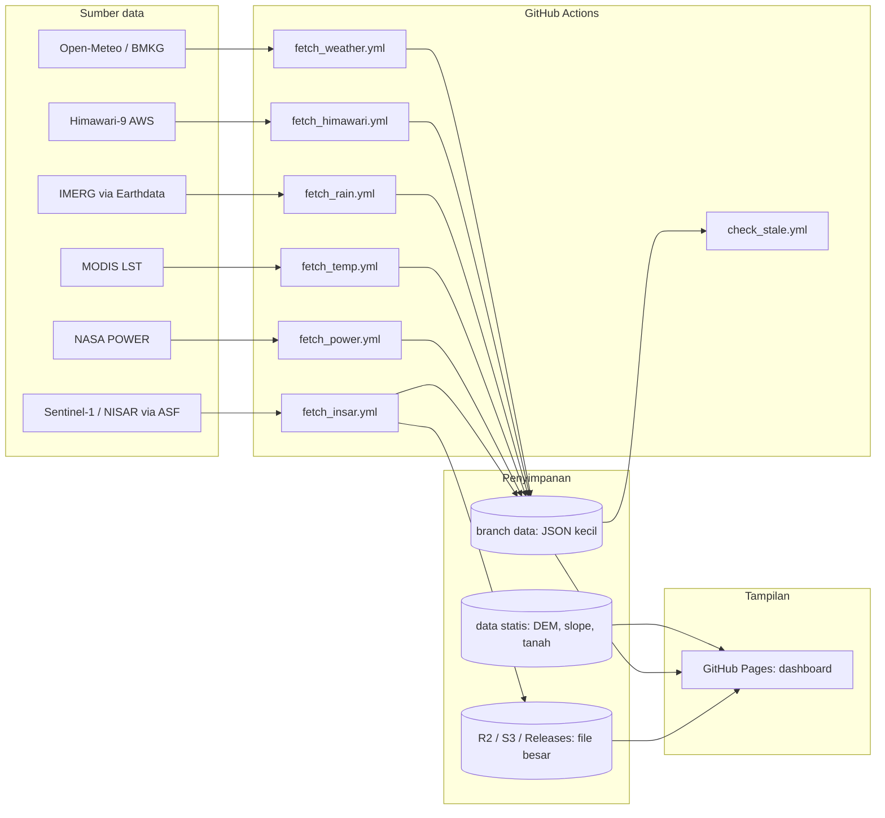

# Arsitektur Pemantauan Satelit dengan GitHub Actions

> **Tujuan:** menarik data hujan, suhu, elevasi/kemiringan, dan pergeseran tanah untuk wilayah Jawa Barat secara otomatis, menyimpannya di GitHub, lalu menampilkannya di dashboard.
> **Prinsip utama:** jadwal pengambilan data **mengikuti seberapa sering sumber datanya benar-benar berubah**, bukan dipaksa tiap 10 menit.
> **Disusun:** 27 Oktober 2026

---

## 1. Ringkasan keputusan arsitektur

| Keputusan | Pilihan | Alasan |
|---|---|---|
| Penjadwal | GitHub Actions (`cron`) | Gratis untuk repo publik, tanpa server |
| Penyimpanan data ringan | Branch `data` (file JSON kecil) | Riwayat commit tidak mengotori branch kode |
| Penyimpanan data besar | Cloudflare R2 / S3 / GitHub Releases | Jangan simpan raster mentah di repo |
| Tampilan | Dashboard statis di GitHub Pages | Membaca JSON dari branch `data` |
| Frekuensi | Berbeda per lapisan data | Menghemat kuota dan menghindari run sia-sia |
| Kredensial | GitHub Secrets | Tidak pernah ditulis di kode |

---

## 2. Lapisan data dan jadwal

| # | Lapisan | Sumber | Frekuensi data sumber | Jadwal workflow (UTC) | Setara WIB |
|---|---|---|---|---|---|
| 1 | Cuaca terkini (hujan, suhu) | Open-Meteo, BMKG | ~Tiap jam | `*/30 * * * *` | Tiap 30 menit |
| 2 | Awan/hujan real-time *(opsional)* | Himawari-9 (bucket AWS `noaa-himawari9`) | 10 menit | `*/20 * * * *` | Tiap 20 menit |
| 3 | Hujan satelit | GPM IMERG Early (`GPM_3IMERGHHE`) | 30 menit, jeda ~4 jam | `5 * * * *` | Tiap jam, menit ke-5 |
| 4 | Hujan final | IMERG Final | Jeda beberapa bulan | `0 21 * * 6` | Minggu 04:00 |
| 5 | Suhu permukaan | MODIS/VIIRS LST | Harian | `0 18 * * *` | Tiap hari 01:00 |
| 6 | Riwayat satelit | NASA POWER | Harian, jeda beberapa hari | `30 18 * * *` | Tiap hari 01:30 |
| 7 | Pergeseran tanah | Sentinel-1 / NISAR via ASF HyP3 | 6-12 hari | `0 20 * * 6` | Minggu 03:00 |
| 8 | Elevasi dan kemiringan | Copernicus GLO-30 / DEMNAS | Statis | Manual, sekali | - |
| 9 | Jenis tanah | BBSDLP / SoilGrids | Statis | Manual, sekali | - |

**Catatan jadwal:**
- GitHub memakai **UTC**. WIB = UTC + 7 jam.
- Jadwal `cron` GitHub **tidak presisi** dan sering tertunda 5-30 menit saat beban tinggi. Ini tidak masalah untuk data yang berubah per jam atau per hari.
- Hindari menjadwalkan tepat di menit 0 untuk lapisan yang sering berjalan, karena beban GitHub memuncak di jam bulat.
- NISAR: rilis publik data L-band dimulai 20 Juli 2026 (observasi sejak 17 Juni 2026), dan reprocessing diperkirakan selesai akhir 2026. Cek dulu apakah wilayah Anda sudah tersedia di ASF sebelum mengandalkannya.

---

## 3. Diagram alur



Versi teks (jika Mermaid tidak tampil):

```
 SUMBER            PENJADWAL (GitHub Actions)       PENYIMPANAN            TAMPILAN
 Open-Meteo/BMKG ─▶ fetch_weather   (30 mnt) ─┐
 Himawari-9      ─▶ fetch_himawari  (20 mnt) ─┤
 IMERG           ─▶ fetch_rain      (1 jam)  ─┼─▶ branch data (JSON) ─▶ GitHub Pages
 MODIS LST       ─▶ fetch_temp      (harian) ─┤        │                 (dashboard)
 NASA POWER      ─▶ fetch_power     (harian) ─┤        ▼
 Sentinel-1/NISAR─▶ fetch_insar     (mingguan)┴─▶ R2/S3/Releases (file besar)
                    check_stale     (tiap jam) ─▶ buat Issue jika data basi
 DEM/slope/tanah ─▶ (manual, sekali) ─▶ data/static ─▶ dashboard
```

---

## 4. Struktur repositori

```
repo/
├── .github/workflows/
│   ├── fetch_weather.yml
│   ├── fetch_himawari.yml        # opsional
│   ├── fetch_rain.yml
│   ├── fetch_temp.yml
│   ├── fetch_power.yml
│   ├── fetch_insar.yml
│   └── check_stale.yml
├── config/
│   └── locations.json            # daftar titik pantau
├── scripts/
│   ├── common.py                 # fungsi bersama
│   ├── fetch_weather.py
│   ├── fetch_rain.py
│   ├── fetch_temp.py
│   ├── fetch_power.py
│   ├── fetch_insar.py
│   ├── build_slope.py            # dijalankan manual sekali
│   └── check_stale.py
├── docs/                         # dashboard (GitHub Pages)
│   └── index.html
├── requirements.txt
└── README.md

branch `data` (terpisah dari kode):
├── latest/                       # status terkini, SELALU ditimpa
│   ├── weather.json
│   ├── rain.json
│   ├── temp.json
│   ├── power.json
│   └── insar.json
├── history/                      # ringkasan harian (CSV), bukan snapshot per update
└── static/
    ├── slope_summary.json
    └── soil_summary.json
```

Memakai branch `data` terpisah menjaga riwayat `main` tetap bersih dari ribuan commit otomatis.

---

## 5. Skema file data

Setiap file JSON memakai bentuk yang sama agar dashboard mudah membacanya dan mendeteksi data basi.

```json
{
  "layer": "weather",
  "source": "open-meteo",
  "observed_utc": "2026-10-27T03:00",
  "points": [
    {
      "id": "bandung",
      "name": "Bandung",
      "lat": -6.91,
      "lon": 107.61,
      "temperature_2m": 24.1,
      "precipitation": 0.0
    }
  ]
}
```

- `observed_utc` adalah **waktu observasi dari sumber**, bukan waktu skrip berjalan. Dengan begitu file hanya berubah ketika data benar-benar baru, dan pengecekan "basi" menjadi akurat.
- Tambahkan `fetched_utc` hanya jika Anda sengaja ingin commit tiap run.

`config/locations.json`:

```json
[
  {"id": "bandung",  "name": "Bandung",  "lat": -6.91, "lon": 107.61},
  {"id": "garut",    "name": "Garut",    "lat": -7.21, "lon": 107.91},
  {"id": "bogor",    "name": "Bogor",    "lat": -6.60, "lon": 106.80}
]
```

---

## 6. Persiapan awal (sekali saja)

### 6.1 Buat repo dan branch `data`

```bash
git init satelit-jabar && cd satelit-jabar
# ... tambahkan kode, commit ke main, lalu hubungkan ke GitHub ...

# buat branch data kosong
git checkout --orphan data
git rm -rf .
mkdir -p latest history static
echo "{}" > latest/.keep
git add . && git commit -m "init data branch"
git push origin data
git checkout main
```

### 6.2 Daftar akun yang diperlukan

| Akun | Untuk | Catatan |
|---|---|---|
| NASA Earthdata | IMERG, MODIS, Sentinel-1, NISAR | Setujui aplikasi *ASF Data Access* dan *GES DISC* di profil. Token berlaku sekitar 60 hari. |
| Google Earth Engine *(opsional)* | Alternatif untuk hujan, suhu, DEM | Mode non-komersial. |
| Copernicus Data Space *(opsional)* | Sentinel resmi ESA | Token login berumur singkat. |
| Open-Meteo, NASA POWER, NASA GIBS | Cuaca dan riwayat | Tanpa key. Cek batas pemakaian di dokumentasi masing-masing. |

### 6.3 Simpan secret

Buka **Settings → Secrets and variables → Actions → New repository secret**:

| Nama secret | Isi |
|---|---|
| `EARTHDATA_TOKEN` | Token dari urs.earthdata.nasa.gov |
| `R2_ACCESS_KEY_ID`, `R2_SECRET_ACCESS_KEY`, `R2_ENDPOINT`, `R2_BUCKET` | Hanya jika memakai Cloudflare R2 |

Jangan pernah menulis token di kode, log, atau commit.

### 6.4 Izin workflow

**Settings → Actions → General → Workflow permissions** → pilih **Read and write permissions**, supaya workflow bisa melakukan push ke branch `data` dan membuka Issue.

---

## 7. Kode inti

### 7.1 `requirements.txt`

```
requests
earthaccess
asf_search
xarray
h5netcdf
numpy
```

### 7.2 `scripts/common.py`

```python
import json
import os
import pathlib

# Folder hasil checkout branch `data`
OUT = pathlib.Path(os.environ.get("DATA_DIR", "data-out"))


def write_if_changed(rel_path: str, payload: dict) -> bool:
    """Tulis JSON hanya jika isinya berbeda. Mengembalikan True jika berubah."""
    path = OUT / rel_path
    path.parent.mkdir(parents=True, exist_ok=True)
    new_text = json.dumps(payload, ensure_ascii=False, indent=2, sort_keys=True)
    if path.exists() and path.read_text(encoding="utf-8") == new_text:
        print(f"{rel_path}: tidak ada perubahan")
        return False
    path.write_text(new_text, encoding="utf-8")
    print(f"{rel_path}: diperbarui")
    return True
```

### 7.3 `scripts/fetch_weather.py` (lapisan paling mudah, tanpa key)

```python
import json
import requests
from common import write_if_changed

with open("config/locations.json", encoding="utf-8") as f:
    locations = json.load(f)

points, observed = [], None
for loc in locations:
    r = requests.get(
        "https://api.open-meteo.com/v1/forecast",
        params={
            "latitude": loc["lat"],
            "longitude": loc["lon"],
            "current": "temperature_2m,precipitation",
            "timezone": "UTC",
        },
        timeout=30,
    )
    r.raise_for_status()
    cur = r.json()["current"]
    observed = max(observed or cur["time"], cur["time"])
    points.append({
        **loc,
        "temperature_2m": cur["temperature_2m"],
        "precipitation": cur["precipitation"],
    })

write_if_changed("latest/weather.json", {
    "layer": "weather",
    "source": "open-meteo",
    "observed_utc": observed,
    "points": points,
})
```

### 7.4 Kerangka `scripts/fetch_rain.py` (IMERG)

```python
import datetime as dt
import earthaccess
from common import write_if_changed

earthaccess.login(strategy="environment")   # membaca EARTHDATA_TOKEN

now = dt.datetime.now(dt.timezone.utc)
results = earthaccess.search_data(
    short_name="GPM_3IMERGHHE",
    temporal=(now - dt.timedelta(hours=8), now),
    bounding_box=(106.0, -7.9, 108.9, -5.8),   # kira-kira Jawa Barat; sesuaikan
)
if not results:
    raise SystemExit("Tidak ada granule IMERG baru")

latest = results[-1]
files = earthaccess.download([latest], "tmp")

# TODO: buka file dengan xarray, ambil variabel curah hujan (precipitation),
#       hitung nilai per titik di config/locations.json, lalu tulis ringkasannya.
summary = {"layer": "rain", "source": "gpm-imerg-early",
           "observed_utc": latest["umm"]["TemporalExtent"]["RangeDateTime"]["EndingDateTime"],
           "points": []}
write_if_changed("latest/rain.json", summary)
```

Nama variabel dan koordinat di file IMERG perlu diperiksa langsung (`xarray.open_dataset(...)` lalu cek `ds.variables`), karena struktur bisa berbeda antar versi produk.

### 7.5 `scripts/check_stale.py`

```python
import datetime as dt
import json
import pathlib
import sys

# batas "basi" per lapisan (jam)
LIMITS = {"weather": 3, "rain": 8, "temp": 48, "power": 96, "insar": 24 * 14}
base = pathlib.Path("data-out/latest")
stale = []

for layer, max_hours in LIMITS.items():
    p = base / f"{layer}.json"
    if not p.exists():
        stale.append(f"{layer}: file belum ada")
        continue
    obs = json.loads(p.read_text()).get("observed_utc")
    if not obs:
        stale.append(f"{layer}: tidak ada observed_utc")
        continue
    t = dt.datetime.fromisoformat(obs.replace("Z", "+00:00"))
    if t.tzinfo is None:
        t = t.replace(tzinfo=dt.timezone.utc)
    age = (dt.datetime.now(dt.timezone.utc) - t).total_seconds() / 3600
    if age > max_hours:
        stale.append(f"{layer}: umur {age:.1f} jam (batas {max_hours})")

if stale:
    print("\n".join(stale))
    sys.exit(1)       # gagalkan job -> memicu notifikasi / Issue
print("Semua lapisan segar")
```

---

## 8. Workflow GitHub Actions

### 8.1 Templat dasar (`fetch_weather.yml`)

```yaml
name: fetch-weather
on:
  schedule:
    - cron: "*/30 * * * *"
  workflow_dispatch:

concurrency:
  group: fetch-weather
  cancel-in-progress: false

permissions:
  contents: write

jobs:
  run:
    runs-on: ubuntu-latest
    timeout-minutes: 5
    steps:
      - name: Checkout kode (main)
        uses: actions/checkout@v4

      - name: Checkout data (branch data)
        uses: actions/checkout@v4
        with:
          ref: data
          path: data-out

      - uses: actions/setup-python@v5
        with:
          python-version: "3.12"
          cache: pip

      - run: pip install -r requirements.txt

      - name: Ambil data
        run: python scripts/fetch_weather.py

      - name: Commit jika berubah
        working-directory: data-out
        run: |
          git config user.name  "github-actions[bot]"
          git config user.email "41898282+github-actions[bot]@users.noreply.github.com"
          git add latest/weather.json
          if ! git diff --cached --quiet; then
            git commit -m "update weather"
            git pull --rebase origin data
            git push origin data
          fi
```

### 8.2 Variasi untuk lapisan lain

| Workflow | `cron` | Skrip | Secret tambahan | `timeout-minutes` |
|---|---|---|---|---|
| `fetch_rain.yml` | `5 * * * *` | `fetch_rain.py` | `EARTHDATA_TOKEN` | 10 |
| `fetch_temp.yml` | `0 18 * * *` | `fetch_temp.py` | `EARTHDATA_TOKEN` | 15 |
| `fetch_power.yml` | `30 18 * * *` | `fetch_power.py` | - | 5 |
| `fetch_insar.yml` | `0 20 * * 6` | `fetch_insar.py` | `EARTHDATA_TOKEN`, R2 | 30 |

Untuk lapisan yang butuh token, tambahkan pada langkah "Ambil data":

```yaml
        env:
          EARTHDATA_TOKEN: ${{ secrets.EARTHDATA_TOKEN }}
```

Satu workflow per lapisan dengan `concurrency` terpisah membuat kegagalan satu sumber tidak mengganggu yang lain. Perintah `git pull --rebase` sebelum push mencegah konflik saat beberapa workflow menulis ke branch `data` hampir bersamaan.

### 8.3 Pemantau data basi (`check_stale.yml`)

```yaml
name: check-stale
on:
  schedule:
    - cron: "17 * * * *"
  workflow_dispatch:

permissions:
  contents: read
  issues: write

jobs:
  check:
    runs-on: ubuntu-latest
    timeout-minutes: 3
    steps:
      - uses: actions/checkout@v4
      - uses: actions/checkout@v4
        with: { ref: data, path: data-out }
      - uses: actions/setup-python@v5
        with: { python-version: "3.12" }
      - id: check
        run: python scripts/check_stale.py
        continue-on-error: true
      - name: Buka Issue jika ada data basi
        if: steps.check.outcome == 'failure'
        uses: actions/github-script@v7
        with:
          script: |
            await github.rest.issues.create({
              owner: context.repo.owner,
              repo: context.repo.repo,
              title: `Data basi terdeteksi (${new Date().toISOString()})`,
              body: 'Cek log workflow check-stale dan workflow fetch terkait.'
            });
```

Versi sederhana ini membuat Issue baru tiap jam selama masalah berlanjut. Untuk produksi, tambahkan pengecekan agar tidak membuat Issue ganda (misalnya cari Issue terbuka dengan judul serupa dulu).

---

## 9. Dashboard

- Simpan halaman statis di `docs/index.html`, lalu aktifkan **Settings → Pages → Deploy from a branch → `main` / `/docs`**.
- Dashboard membaca JSON dari URL raw branch `data`:

```
https://raw.githubusercontent.com/<USER>/<REPO>/data/latest/weather.json
```

- URL raw di-cache oleh CDN GitHub selama beberapa menit, jadi data di dashboard bisa terlambat sedikit. Itu wajar untuk jadwal 30 menit ke atas.
- Tampilkan `observed_utc` di dashboard dan beri tanda peringatan jika umurnya melebihi batas pada `LIMITS`.
- Untuk peta, pakai Leaflet atau MapLibre dengan tile NASA GIBS (IMERG, MODIS) sebagai latar.

---

## 10. Kuota dan biaya

GitHub menagih waktu run per job, dibulatkan ke atas ke menit terdekat.

| Workflow | Run/bulan (perkiraan) | Menit/bulan (≈1 mnt per run) |
|---|---|---|
| fetch_weather (30 mnt) | ~1.440 | ~1.440 |
| fetch_rain (1 jam) | ~720 | ~720 - 1.400 |
| check_stale (1 jam) | ~720 | ~720 |
| fetch_temp, fetch_power (harian) | ~60 | ~100 - 300 |
| fetch_insar (mingguan) | ~4 | ~50 - 120 |
| **Total kasar** | | **~3.000 - 4.000** |

Kesimpulan:
- **Repo publik:** Actions standar gratis, jadi kuota bukan masalah.
- **Repo privat:** batas gratis sekitar 2.000 menit per bulan, sehingga rancangan di atas **akan melebihinya**. Solusinya: jadikan repo publik, perlambat jadwal (misalnya cuaca tiap jam), atau pindahkan penjadwal ke VPS kecil dengan `cron`.
- Angka di atas perkiraan. Cek halaman penagihan GitHub Anda dan kebijakan terbaru sebelum mengandalkannya.

---

## 11. Aturan agar sistem tetap sehat

1. **Timpa, jangan menumpuk.** File di `latest/` selalu ditimpa. Riwayat disimpan sebagai ringkasan harian.
2. **Commit hanya jika berubah.** Gunakan `write_if_changed` dan `git diff --cached --quiet`.
3. **Raster dan file besar jangan masuk repo.** Simpan di R2/S3/Releases, lalu catat tautannya di JSON.
4. **Selalu isi `observed_utc`** supaya data basi mudah terdeteksi.
5. **Rotasi token Earthdata sebelum kedaluwarsa** (sekitar 60 hari). Pasang pengingat kalender.
6. **Repo publik tanpa aktivitas:** GitHub menonaktifkan workflow terjadwal setelah sekitar 60 hari tanpa aktivitas repo. Commit otomatis ke branch `data` biasanya cukup menjaganya aktif, tetapi tetap pantau.
7. **Aktifkan notifikasi kegagalan Actions** di pengaturan akun GitHub.
8. **Hormati batas API gratis.** Jangan menambah titik pantau atau frekuensi tanpa mengecek ketentuan layanan.
9. **Pin versi** pustaka di `requirements.txt` saat sistem sudah stabil.

---

## 12. Urutan pengerjaan (fase)

| Fase | Pekerjaan | Hasil |
|---|---|---|
| **0** | Buat repo, branch `data`, izin workflow | Fondasi siap |
| **1** | `fetch_weather` + `common.py` + `check_stale` | Data cuaca mengalir tiap 30 menit |
| **2** | Dashboard sederhana di `docs/` | Data terlihat di peta atau tabel |
| **3** | Akun Earthdata, lalu `fetch_rain` dan `fetch_temp` | Lapisan satelit murni |
| **4** | `build_slope.py` (DEM) dan ringkasan jenis tanah | Lapisan statis |
| **5** | `fetch_insar` (HyP3) mingguan | Pergeseran tanah |
| **6** | Himawari-9 *(opsional)*, penyimpanan R2 | Pantauan real-time |
| **7** | Skor kerawanan longsor/banjir gabungan | Produk analisis |

Kerjakan berurutan dan pastikan tiap fase stabil minimal beberapa hari sebelum lanjut.

---

## 13. Batasan yang perlu disadari

- Open-Meteo dan NASA POWER adalah **model/reanalisis**, bukan pengukuran satelit langsung. Untuk satelit murni, gunakan IMERG dan MODIS.
- Pergeseran tanah (InSAR) memerlukan pemrosesan berat dan tidak cocok untuk pembaruan menit-an.
- Estimasi hujan satelit di wilayah pegunungan Jawa Barat dapat meleset. Validasi dengan stasiun BMKG.
- Dokumen ini adalah rancangan. Nama produk, batas layanan, dan struktur file data dapat berubah, jadi cek dokumentasi resmi masing-masing penyedia saat implementasi.

---

## 14. Daftar periksa (checklist)

- [ ] Repo dibuat (publik atau privat sesuai kuota)
- [ ] Branch `data` dibuat dan di-push
- [ ] Workflow permissions: *Read and write*
- [ ] Secret `EARTHDATA_TOKEN` tersimpan
- [ ] `config/locations.json` diisi titik pantau
- [ ] `fetch_weather` berhasil dijalankan manual (`workflow_dispatch`)
- [ ] `check_stale` aktif dan notifikasi email menyala
- [ ] GitHub Pages aktif dan dashboard membaca JSON
- [ ] Pengingat rotasi token Earthdata di kalender
